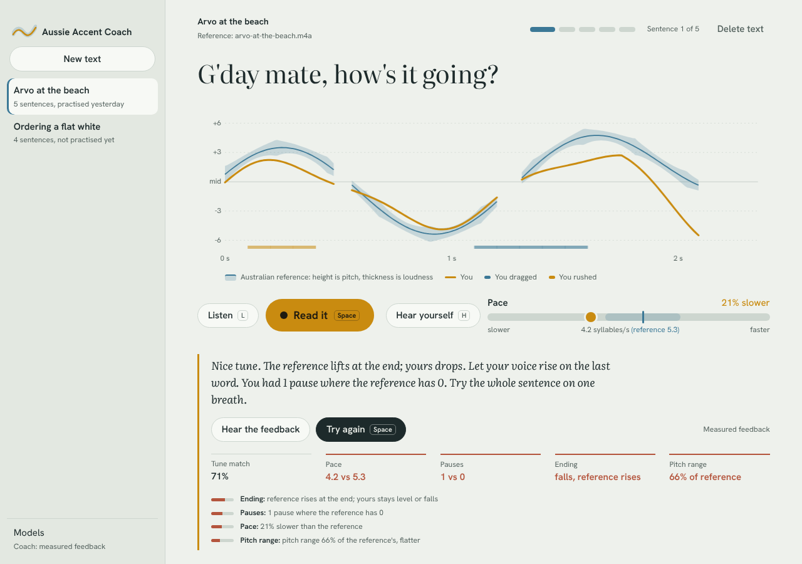
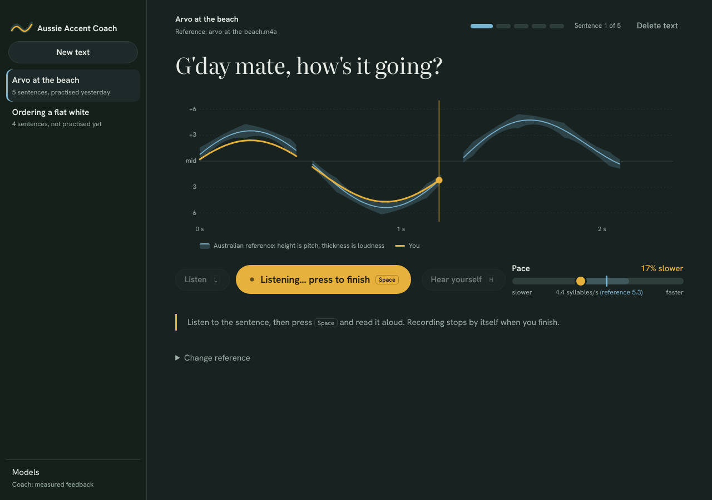
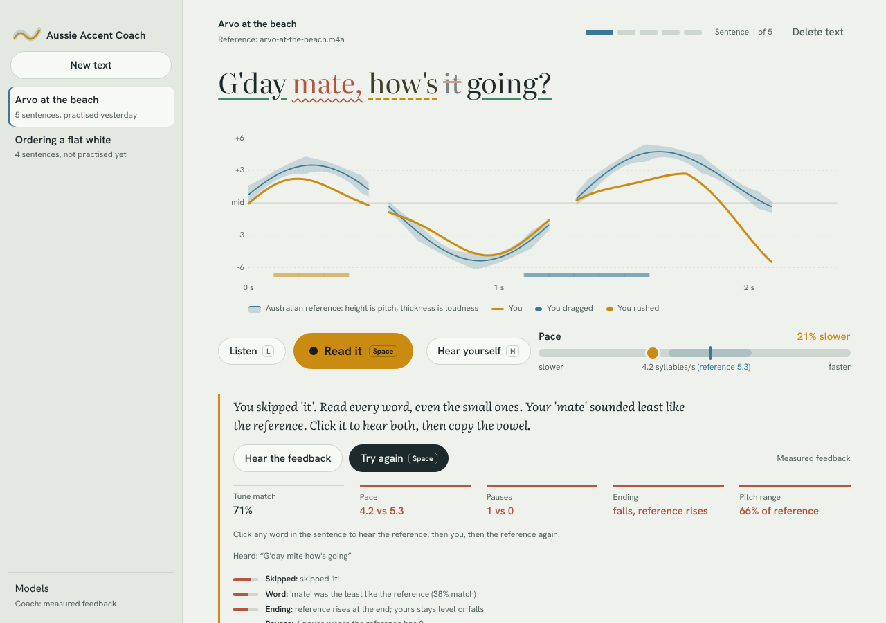
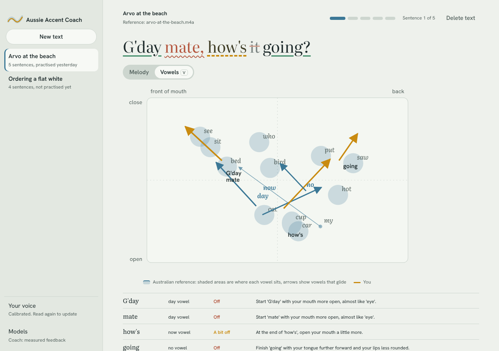
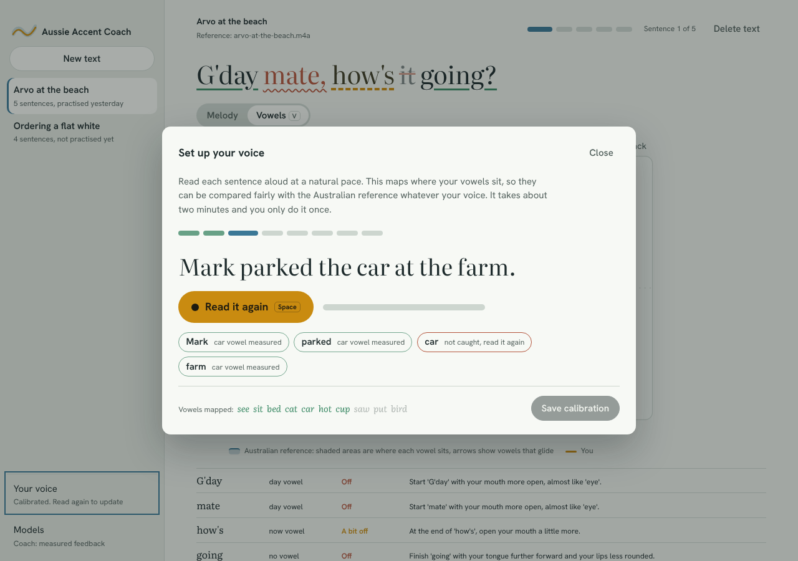

# Coach engine (Aussie Accent Coach)

This folder is the engine of **Coach** in RAD (sidebar → Media → Coach). It came from the standalone
Aussie Accent Coach app. In RAD:

- These crates are linked into `app/src-tauri` by path. The Tauri glue is in `app/src-tauri/src/accent_coach/`, and the Svelte UI is in `app/ui/src/components/coach/`.
- Whisper and Silero run in `rad-coach-asr` (this workspace; `../scripts/build-coach.sh`), not in RAD's process. whisper.cpp's ggml can't share a process with the llama.cpp RAD already links. The protocol is in `crates/asr/src/remote.rs`.
- The LLM coach (`crates/coach/src/llm.rs`) takes the process's llama.cpp backend, rad-local's, instead of starting its own.
- The original app's notes follow. Paths like `scripts/…` are `coach/scripts/…` in RAD, and the `npm run tauri dev` instructions apply to the standalone app only.

---

# Aussie Accent Coach

A local-first macOS app, written in Rust, for practising a General Australian accent.
You read a sentence aloud; the app compares your pitch, pace, pauses and ending with an
Australian reference reading and gives short, specific feedback.

Nothing leaves your Mac. The only network use is the optional model downloader.

## What works today (milestones M0–M3)

| Area | Status |
| --- | --- |
| Tauri v2 app, Practice screen, text library | Working |
| Microphone capture, playback, file decoding (WAV, MP3, M4A/AAC, FLAC) | Working |
| Live pitch (YIN) drawn over the reference "melody", live pace bar | Working |
| Reference from your own narration (split into sentences by pauses) or a macOS Australian voice | Working |
| Per-sentence comparison: tune match (DTW-aligned), pace, pauses, rising or falling ending, pitch range, where you dragged or rushed | Working |
| Coach: grounded rule-based feedback; validator that rejects any comment not backed by a measurement | Working |
| Local LLM coach (llama.cpp, JSON-grammar constrained) | Built behind `--features metal`; needs a downloaded GGUF model |
| Session memory: per-feature trends feed the coach ("pace improving, 4 sessions") | Working |
| Model manager: resumable, checksum-verified downloads | Working |
| Per-word pronunciation grades (green, amber, red; solid, dashed, wavy underline) from wav2vec2 phonemes + goodness of pronunciation | M2: built; needs the phoneme model set up (below) |
| Word timings and skipped-word detection (Whisper), Silero VAD for pauses | M2: built; needs the Whisper and Silero models (Models screen) |
| Click a word: reference, you, reference (A/B/A) | M2: built |
| Voice calibration: eight short sentences map your vowel space (needs Whisper) | M3: built |
| Vowel chart: the reference's vowels as a map, this sentence's vowels as arrows, yours in gold | M3: built |
| Named feedback on the Australian vowels in 'day', 'my', 'no', 'now', 'who' (FACE, PRICE, GOAT, MOUTH, GOOSE), with what to change | M3: built |
| Non-rhotic R: flags an R pronounced where Australians drop it ("car", "better"), allows linking R ("far away") | M3: built |
| Voice picker: Australian macOS voices labelled male/female and basic/Enhanced/Premium, preview, remembered across launches | built |
| Whole page: read a pasted page in one go, every word marked in place, play back your reading with words lit, Listen to the whole page | built |
| PDF import: Open PDF… turns each page with text into a whole page to read, with page-by-page navigation (needs a text layer, not scans) | built |
| Neural voice (Chatterbox) cloned from a 5–20 s clip of an Australian speaker, with a consent record | built, needs setup below |

## Run it on your Mac

Requirements: macOS 14+, Apple Silicon, Xcode command-line tools, Rust (stable), Node 20+.

```sh
xcode-select --install            # if not already installed
curl https://sh.rustup.rs -sSf | sh

cd app
npm install
npm run tauri dev                         # prosody only, fastest build
npm run tauri dev -- --features speech     # + Whisper, Silero VAD, phoneme scoring (CPU)
npm run tauri dev -- --features metal      # everything, GPU-accelerated: speech + local LLM coach
```

The first `speech`/`metal` build compiles whisper.cpp (and llama.cpp for `metal`); allow 10–15 minutes.

### Pronunciation scoring setup (M2, once)

1. In the app, open **Models** and download **Whisper small.en** and **Silero VAD**.
2. Export the phoneme model (needs Python 3.10+; downloads about 1.3 GB once):

   ```sh
   python3 -m venv .venv && source .venv/bin/activate
   pip install torch transformers onnx onnxruntime
   python3 scripts/setup_phoneme_model.py
   ```

   This writes `wav2vec2-phonemes.onnx` (int8, ~330 MB), its vocabulary, and a matching
   `libonnxruntime.dylib` into the models folder. `brew install onnxruntime` also works for the runtime.
3. Back in **Models**, choose **Reload speech models**. All three engines should read *Ready*.

How the scoring works: the phoneme model reads the phones off the *Australian reference
recording*, so there is no American or British dictionary marking correct Aussie vowels as
wrong. Your attempt is force-aligned to those phones and each phone is scored relative to how
clearly the model heard the same phone from the reference speaker (goodness of
pronunciation). Whisper places the words and notices any you skipped.

The first time you press **Read it**, macOS asks for microphone access. In `tauri dev` the
prompt is attributed to your terminal app; in the bundled app it uses the app's own
description. If you declined, re-enable it in System Settings › Privacy & Security › Microphone.

Build a signed-ready `.app` and `.dmg`:

```sh
cd app
npm run tauri build -- --features metal
```

### Vowel feedback setup (M3, once)

Vowel feedback finds each word with Whisper, so finish the M2 setup first (at least Whisper).
Then click **Your voice** in the sidebar and read the eight short calibration sentences. The app
measures where your vowels sit so they can be compared fairly with the reference speaker's,
whatever your voice. Recalibrate any time.

How it works: a bundled pronunciation lexicon (CMUdict plus Australian words like *arvo* and
*esky*) says which vowel each word has, by Wells lexical set. Only that category is used; the
dictionary's American pronunciations are never a target. Each stressed vowel is located inside
its word (from the phoneme model's phones, or loudness peaks without it) and its formants are
measured at the start, middle and end. Both speakers are normalised (Lobanov) over the same
stable vowels, so a deep voice and a high voice saying the same vowel land in the same place.
A pronounced R shows as F3 dropping toward F2 near the R.

### Better voices (optional)

The built-in Karen voice is the small "basic" one and sounds robotic. Free, much more natural
Australian voices (Lee is male; Karen and Matilda are female) are in System Settings ›
Accessibility › Spoken Content › System Voice › Manage Voices… › English (Australia). Choose the
**Premium** versions. The voice picker has a button that opens System Settings and a refresh button.

For a neural voice copied from any Australian speaker, set up Chatterbox (MIT licence, ~2 GB):

```sh
brew install python@3.11
python3.11 -m venv .venv-voice && source .venv-voice/bin/activate
pip install chatterbox-tts
python3 scripts/setup_voice_model.py
```

Then in the app, open **Models** › **Reload speech models**, choose **+ Add neural voice…**, and
pick a 5–20 second clip of one Australian speaker talking clearly. Only use a voice with the
speaker's permission; the app records that consent. The first sentence loads the model, which
takes a while. After that, each sentence takes a few seconds on Apple silicon.

## Using it

1. Pick a text in the sidebar (a sample "Arvo at the beach" is added on first run) or paste your own with **New text**. Each sentence or line becomes one practice step.
2. Give it a reference. Best: **Attach narration** with a recording of an Australian reading the whole text, pausing a little between sentences. Quick stand-in: **Use this voice** with a macOS Australian voice (Karen ships with macOS; Lee and the Siri voices download in System Settings › Accessibility › Spoken Content).
3. **Listen** (`L`) to the sentence and watch the melody: height is pitch, thickness is loudness, so stressed syllables swell.
4. **Read it** (`Space`) and trace the gold line along the ribbon. Recording stops by itself about a second after you finish.
5. Read the feedback, **Hear yourself** (`H`), try again, or move on with `→`.
6. Switch the graph to **Vowels** (`V`) to see this sentence's vowels on the Australian vowel map: blue is the reference, gold is you, arrows are vowels that glide. The list under the chart says what to change for each word.

## Repository layout

```text
Cargo.toml              workspace
models.toml             pinned model manifest
crates/
  analysis/             pitch (YIN), VAD, speaking rate, DTW, LPC formants, Lobanov, live analyser, comparison
  audio-io/             cpal capture and playback, band-limited resampler, symphonia decoding, WAV writing
  coach/                CoachInput/Output schema, issue extraction, rules coach, validator, llama.cpp backend
  reference/            ReferenceSource trait, narration splitter, macOS system voice, sentence splitter
  store/                SQLite schema and migrations, attempts, per-feature stats, coach history
  models/               manifest parsing, resumable SHA-256-verified downloader
  asr/                  Whisper word timings + Silero VAD (whisper-rs), transcript-to-sentence word alignment
  phonetics/            wav2vec2 via ONNX Runtime, CTC greedy decode and forced alignment, GOP, word grades
  vowels/               lexicon (CMUdict + Aussie words), lexical sets, vowel location and formants,
                        Lobanov normalisation, target-vowel and non-rhotic scoring, calibration passage
scripts/
  setup_phoneme_model.py  exports the phoneme model to ONNX and installs ONNX Runtime
  setup_voice_model.py    installs the Chatterbox neural voice; voice_server.py is its sidecar

app/
  src-tauri/            Tauri v2 commands, events, app state, Info.plist and entitlements
  ui/                   Svelte 5 + TypeScript; canvas melody, pace bar, coach panel
```

The engine crates have no Tauri dependency and test headless:

```sh
cargo test                       # engine crates (default members)
cargo clippy --all-targets -- -D warnings
cargo check -p coach --features llama
cargo check -p asr --features whisper
cargo test -p phonetics --features onnx   # set PHONETICS_TEST_DIR to run the ONNX smoke test
cargo run -p vowels --example chart_demo   # vowel-chart JSON for two synthetic speakers
cargo run -p reference --example measure_words -- heed.wav hay.wav   # measure vowels in word recordings
cd app && npm run check && npm run build
```

Data lives in `~/Library/Application Support/AussieAccentCoach/` (`coach.sqlite`, `audio/`, `models/`).

## Notes and known limits

- **Sentence splitting of narration** uses the longest pauses. If a narrator pauses mid-sentence longer than between sentences, clips will be off by one. Word alignment now exists, so splitting by transcript is a small follow-up.
- **Word grade thresholds** (green ≥ 70%, amber ≥ 45%) are first guesses. Tune `ScoreConfig` once you have a few sessions of real attempts; the reference speaker's own repeat-to-repeat variation is the right yardstick.
- **The M2 models have not been run on real speech yet** (the build machine had no access to Hugging Face). The ONNX path was tested end to end with ONNX Runtime 1.29 and a stand-in model; the Whisper path compiles but is unexercised.
- **Pitch range and tune** are measured relative to each speaker's own median, so a deep voice copying a high one is compared fairly.
- **Model URLs** in `models.toml` were written without being able to reach Hugging Face from the build machine. Check each resolves, then pin real SHA-256 hashes (empty hash = trust on first use).
- **Feedback covers** pace, pauses, tune, ending, range, skipped words, which words sound off, the five Australian target vowels, and pronounced R's. The flapped T (*water*, *get it*) is not measured yet.
- **Vowel thresholds** (close < 0.6, off ≥ 1.1 in normalised units) were set on synthetic speakers: an Australian voice with a different vocal tract scored at most 0.28, an American-like learner's FACE scored 1.6. Tune them on real recordings; `vowels::score::{GOOD, FAIR}`.
- **Vowel measurement on real speech** was sanity-checked with espeak-ng words (British and American voices): front/back and open/close come out in textbook order, diphthongs glide the right way, and the American R drops F3 to about 1,800 Hz against 2,300–2,600 Hz for the British voice. It has not been tested on a real Australian narrator.
- **Normalisation needs shared vowels.** A text must contain at least four of the stable vowels (in *see, sit, bed, cat, car, hot, cup, saw, put, bird*), covering front, open and back. Very short texts may not; the Vowels view says so.
- **Lexicon gaps**: words not in CMUdict (names, new slang) are skipped. Add them to `crates/vowels/data/aussie-extra.dict`.
- **Narration rights**: keep uploaded audiobook narration for personal use. Cloned voices (M5) will require a consent record per voice; the database already enforces this.

## Next steps (from the scope)

- **M3 follow-ups**: flapped T; split narration by transcript instead of pauses; tune vowel thresholds on real recordings.
- **M4**: benchmark the LLM coach against the 50-attempt validator test set; tune the prompt.

## Screenshots

These were rendered from the built UI with a mocked backend (the build machine has no microphone).







Third-party data: crates/vowels/data/cmudict.dict.gz is the CMU Pronouncing Dictionary
(first pronunciation of each word), redistributed under its licence in
crates/vowels/data/CMUDICT-LICENSE.
